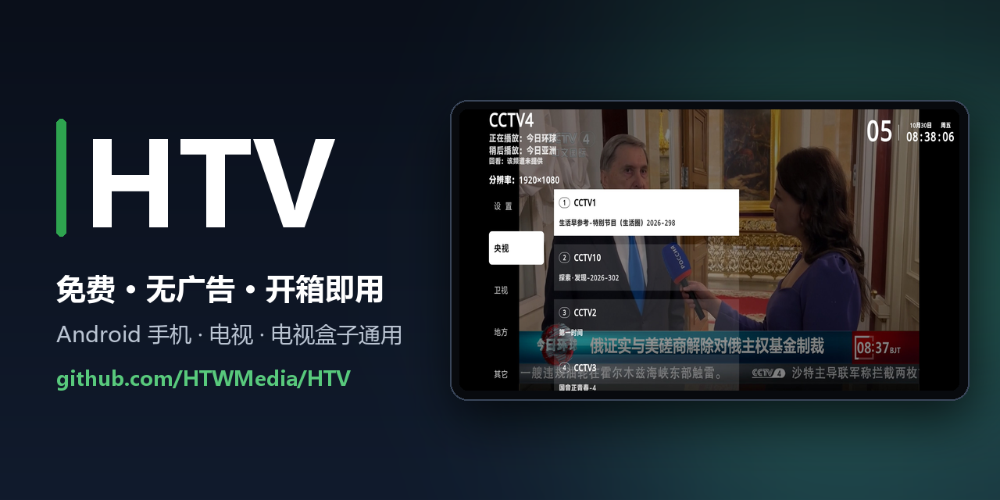
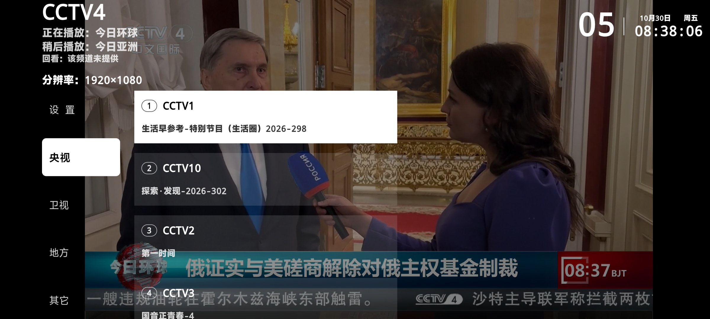
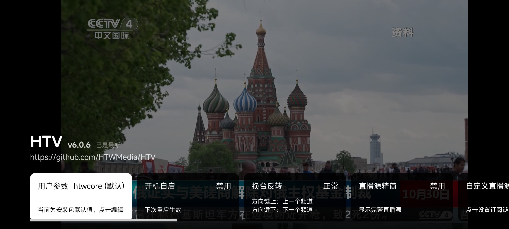

<div align="center">

# HTV · Live TV for Android

**Free, ad-free, works out of the box — a live TV player for Android phones, TVs and TV boxes**

[](https://github.com/HTWMedia/HTV/releases/latest)
[](https://github.com/HTWMedia/HTV/releases/latest)
[](https://github.com/HTWMedia/HTV/releases/latest)
[](https://github.com/HTWMedia/HTV)
[](https://github.com/HTWMedia/HTV/blob/main/LICENSE)

[Download](https://github.com/HTWMedia/HTV/releases/latest) · [Features](#features) · [FAQ](#faq) · [Privacy](#privacy) · [中文](README.md)

</div>

---



<p align="center">
  
  
</p>

---

## About

HTV is a free live-TV app for Android phones, smart TVs and TV boxes. It ships with daily-maintained Chinese live sources (CCTV, provincial satellite and local channels), and when a stream fails it automatically switches to the next available one — no manual fiddling. The UI adapts to both remote controls and touch screens.

- Free, no account, no ads
- One APK for phones and TV boxes (Android 4.4+)
- Sources are health-checked daily on the server side
- Open source (Apache-2.0) — build and audit it yourself

> **Different from TVBox-style shells?** TVBox is an empty player: you have to find
> subscription sources and keep them working yourself. HTV is plug-and-play: the
> server collects, probes and ranks sources every day, so the app works immediately
> after installation. Media traffic goes directly to the stream hosts — nothing is
> relayed through project servers.

## Features

| Feature | Description |
| --- | --- |
| Live channels | CCTV, provincial satellite and local channels, sources updated daily |
| Automatic failover | On playback errors or no picture, switches to the next healthy source |
| Favorites | Long-press OK in the channel list to pin/remove favorites |
| Catch-up TV | Replay recent programs where the source supports it, with a diagnostics panel |
| EPG | Program guide loads automatically, covering the last 7 days |
| Layouts | Switch between grouped and list layouts; pick a specific source per channel |
| Remote-first | Full D-pad / number / OK / menu key navigation, plus touch gestures |
| Network | IPv4 and IPv6 supported |

## Download & install

1. Get the latest APK from [Releases](https://github.com/HTWMedia/HTV/releases/latest)
2. Install it on your phone, or sideload to your TV box via USB / file manager / ADB
3. Allow "install from unknown sources" once if prompted

| File | Device |
| --- | --- |
| `HTV-<version>-armeabi-v7a.apk` | Most TV boxes and older phones (recommended; in-app update uses this) |
| `HTV-<version>.apk` | Universal build (larger, works on phones and boxes) |

## FAQ

### The spinner never stops / no picture

The app tries the next available source after a start timeout. If the whole channel
list fails to load, an on-screen hint appears — press OK to retry.

### A channel doesn't play

Open the info panel and switch to another source ("Source X/Y"). If no source works,
the channel's sources are likely dead — please report it in
[Discussions](https://github.com/HTWMedia/HTV/discussions) and it enters the automated
health-check queue.

### Does it work on an old TV box?

Android 4.4 and above is supported, including common carrier boxes and imported boxes.

### Is it really ad-free and account-free?

Yes. No ads, no sign-up, no paid channels.

### What about catch-up?

Catch-up depends on whether the source provides it. Check "Settings → Catch-up diagnostics"
for the current channel.

### Can I add my own playlist?

Custom sources are supported on request — open a discussion or contact the author.

## Privacy

HTV requires no account and contains no ad or analytics SDKs.

- **Network access** is used only to fetch the channel list and EPG, to check for
  updates on GitHub Releases, and to play the streams themselves.
- **Local data** (favorites, settings, history) stays on your device and is removed on uninstall.
- **Media traffic** connects directly to the stream hosts, not through project servers.
- **Source code** is public in this repository.

## Build from source

```bash
git clone https://github.com/HTWMedia/HTV.git
cd HTV
flutter pub get
flutter build apk --release --split-per-abi
```

Requires Flutter 3.13+ and the Android SDK. The repository contains no stream URLs —
channel data is delivered at runtime by the default source service, which can be
replaced with your own subscription endpoint in the app settings.

## Community

- [GitHub Discussions](https://github.com/HTWMedia/HTV/discussions) — bug reports,
  dead-channel reports, feature requests (searchable and indexed)
- Watch → Custom → Releases to get notified about new versions

## Support

HTV is free with no paywall. Donations are voluntary and unlock nothing.

## Acknowledgements

[my_tv](https://github.com/yaoxieyoulei/my_tv "my_tv")

---

<sub>Live TV · IPTV player · m3u8 / HLS · Android TV · TV box · catch-up TV · EPG · [中文 README](README.md)</sub>
