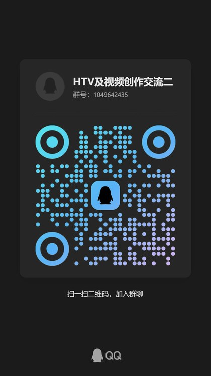

<div align="center">

# HTV · 手机电视直播

**无广告 · 开箱即用 —— 手机与 Android 电视盒子通用的网络电视直播软件**

[](https://github.com/HTWMedia/HTV/releases/latest)
[](https://github.com/HTWMedia/HTV/releases/latest)
[](https://github.com/HTWMedia/HTV/releases/latest)
[](https://github.com/HTWMedia/HTV)
[](https://github.com/HTWMedia/HTV/blob/main/LICENSE)

[立即下载](https://github.com/HTWMedia/HTV/releases/latest) · [官方主页](https://htwmedia.dpdns.org/Home/Download) · [功能特性](#功能特性) · [使用说明](#使用说明) · [常见问题](#常见问题) · [隐私与权限](#隐私与权限) · [English](README.en.md)

</div>

---


<p align="center">
  
  
</p>

---

## 软件简介

HTV 是一款面向 Android 手机、电视与电视盒子的直播播放软件。可使用内置的央视、卫视、地方台、凤凰卫视等常用频道（完整内置源需赞助开通），也可配置自己的订阅源；播放异常时会自行尝试下一个可用源，不需要手动折腾。界面针对遥控器与触屏分别做了适配，电视上用方向键就能换台，手机上滑动即可。

- App 免费使用，无需账号
- 完整内置源需赞助开通，也可配置自定义直播源
- 一套安装包同时适配手机与电视盒子
- 源码公开（Apache-2.0），可自行构建与审计

## 为什么选 HTV

| | HTV | 播放器空壳（TVBox 类） | 常见商业直播 App |
| --- | --- | --- | --- |
| 装完即看 | ✅ 可开通内置常用频道，也可自填订阅源 | ❌ 要自己找订阅源、自己维护 | ✅ |
| 源失效处理 | ✅ 多源频道自动切换，也可手动换源 | ❌ 挂了只能自己再找 | ❌ 通常报错了事 |
| 直播回看 | ✅（源支持时） | 视源而定 | 多为付费功能 |
| 节目单 EPG | ✅ 自动加载 | 视源而定 | 部分支持 |
| 广告 / 账号 | 无广告、免登录 | 无广告 | 广告与登录常见 |
| 价格 | App 免费；完整内置源需赞助 | 免费 | 会员订阅 |

## 功能特性

| 功能 | 说明 |
| --- | --- |
| 电视频道 | 内置央视、卫视、地方台、凤凰卫视等常用频道（完整内置源需赞助开通） |
| 自定义直播源 | 支持填写自己的 m3u / txt 订阅源，也可留空默认源、只加载自定义源 |
| 自动换源 | 播放异常或长时间不出画面时，自动尝试下一个可用源，无需手动干预 |
| 频道收藏 | 频道列表中长按 OK 键即可收藏或取消收藏，收藏的频道集中在列表顶部「收藏」行 |
| 直播回放 | 支持回看最近播过的节目（需直播源支持），可在「设置 → 回看诊断」中查看与诊断 |
| 节目单 EPG | 节目信息自动加载，随时了解正在播什么、接下来播什么 |
| 布局切换 | 面板底部可切换横向分组 / 竖向列表；多源频道可在信息面板中手动切换播放源 |
| 全遥控操作 | 方向键、数字键、OK 键、菜单键均可操作，同时支持手机触屏手势 |
| 网络兼容 | 支持 IPv4 与 IPv6 网络环境，Android 4.4 及以上设备均可安装 |

## 下载与安装

1. 前往 [Releases](https://github.com/HTWMedia/HTV/releases/latest) 下载最新版本的 APK，也可从 [官方主页](https://htwmedia.dpdns.org/Home/Download) 获取
2. 手机直接点击安装；电视 / 盒子可通过 U 盘、文件管理器或 ADB 安装
3. 首次安装如提示「未知来源」，允许一次即可
4. 打开后可先按需配置：开通内置源，或在「设置 → 自定义直播源」填入自己的订阅源

> 建议把 App 加入电视 / 盒子的开机自启动或桌面快捷方式，使用更顺手。

**选哪个安装包？**

| 文件 | 适用设备 |
| --- | --- |
| `HTV-<版本>-armeabi-v7a.apk` | 绝大多数电视盒子、老款手机（默认推荐，App 内自动更新也下载这个） |
| `HTV-<版本>.apk` | 通用包，手机与盒子都能装，体积更大 |

同一个版本内新旧安装包签名一致，可直接覆盖升级，无需卸载。

发布页附件中附有 `SHA256SUMS.txt`，可校验安装包是否完整。

## 内置源与自定义源

- **App 免费**：播放器本身免费使用，无广告、免登录。
- **内置源**：内置的央视、卫视、地方台等常用频道属于增值服务，**完整内置源需赞助开通**；未开通时可先在「设置 → 自定义直播源」使用自己的订阅源。
- **自定义源**：在「设置 → 自定义直播源」填写自己的 m3u / txt 订阅地址即可使用；
  「设置 → 直播源 → 默认源服务」留空时，App 只加载自定义源。

## 使用说明

### 电视 / 盒子（遥控器）

- **换台**：上下方向键 / 数字键，或在屏幕上上下滑动
- **选台**：OK 键 / 单击屏幕
- **收藏**：频道列表中长按 OK 键，收藏或取消收藏
- **回看**：设置 → 回看诊断，可回看最近播过的节目
- **设置**：菜单键 / 帮助键 / 长按 OK 键 / 长按屏幕
- **分组与换源**：面板底部切换横向分组 / 竖向列表；多源频道在信息面板中切换播放源

### 手机（触屏）

- **换台**：屏幕上下滑动
- **选台**：单击屏幕
- **设置**：长按屏幕

## 常见问题

### 一直转圈、不出画面怎么办？

App 会在起播超时后自动尝试下一个可用源。若整个频道列表加载失败，界面会给出状态提示，按 OK 键即可重试。

### 某个频道看不了，是源挂了吗？

先在信息面板里手动切一个源（「源 X/Y」）试试。如果整个频道都不行，基本可以断定这条源失效了——
请到 [Discussions](https://github.com/HTWMedia/HTV/discussions) 按[上面的格式](#加入社区)反馈，
或进 QQ 群（「HTV及视频创作交流二」**1049642435**）说一声；也可以自行换成自己的订阅源。

### 原来的直播软件不能用了，换哪个？

HTV 安装后可以使用内置源，也支持填自己的订阅源，不需要配置播放器内核，适合「只想看直播、不想折腾」的场景。
如果你更习惯自己维护订阅源，也可以继续用 TVBox 类工具，两者不冲突。

### 电视盒子 / 老电视能装吗？

支持 Android 4.4 及以上系统，常见运营商盒子、外贸盒子、智能电视均可安装。
电视端用遥控器操作，界面按方向键导航专门适配过。

### 有没有无广告、免登录的电视直播 App？

HTV 播放器本身没有广告、不需要登录，也不收集观看行为。内置源为增值服务，完整内置源需赞助开通，也可使用自定义源。

### 内置源要收费吗？

App 免费。内置源由项目方维护，**完整内置源需赞助开通**以覆盖维护成本；
如果只想用免费方式，可以在「设置 → 自定义直播源」里填入自己的订阅源。

### 回看功能用不了？

直播回放依赖直播源本身是否提供回看能力，可在「设置 → 回看诊断」中确认当前源的支持情况。

### 节目单显示有延迟？

节目信息（EPG）为异步加载，稍等片刻即可，不影响正常观看。节目单覆盖最近 7 天。

### 支持自己添加直播源吗？

支持。在「设置 → 自定义直播源」填写自己的 m3u / txt 订阅地址即可；
如需私有源搭建等定制服务，可在 [Discussions](https://github.com/HTWMedia/HTV/discussions) 联系作者。

## 隐私与权限

HTV 不需要注册或登录，不接入广告 SDK 与统计 SDK，不会把观看内容或设备信息上传给第三方。

- **网络访问**：仅用于拉取频道列表与节目单、检查更新（GitHub Releases）、播放直播流本身
- **本机数据**：收藏、设置、观看记录只保存在设备本地，卸载即清除
- **源码可审计**：完整 Flutter 源码在本仓库公开，隐私相关行为可自行核查

## 更新记录

- **v6.0.6**：播放异常后自动换源更可靠；长时间观看不再误报「所有源不可用」；回看节目单扩展到 7 天
- **v6.0.0**：新增频道收藏、直播回放（回看）；优化起播策略与自动换源逻辑；加载失败增加状态提示与一键重试；界面与稳定性多项优化

完整历史版本与安装包见 [Releases](https://github.com/HTWMedia/HTV/releases)。

## 从源码构建

本仓库包含完整的 Flutter 源码（[Apache-2.0](LICENSE)）。构建需要 Flutter 3.13+ 与 Android SDK：

```bash
git clone https://github.com/HTWMedia/HTV.git
cd HTV
flutter pub get
flutter build apk --release --split-per-abi
```

> 仓库不存放任何直播源地址：内置源数据在 App 内按需获取，也可在「设置 → 自定义直播源」中替换为自己的订阅接口。

## 加入社区

装完就想知道「源怎么又没了」「下个版本什么时候发」——这里有答案：

| 渠道 | 适合什么 | 入口 |
| --- | --- | --- |
| **GitHub Discussions** | 反馈失效源、提建议、查历史问题（可检索、会被搜索引擎收录） | [进入 Discussions](https://github.com/HTWMedia/HTV/discussions) |
| **QQ 交流群** | 即时交流、反馈失效频道、问用法 | 「HTV及视频创作交流二」**1049642435**（一群 / 二群已满员，扫码见下） |
| **Watch 仓库** | 不发 QQ 也想收到发版通知：点仓库右上角 Watch → Custom → Releases | [HTWMedia/HTV](https://github.com/HTWMedia/HTV) |

新用户先看两篇：**[下载、更新与反馈指引](https://github.com/HTWMedia/HTV/discussions/46)** · **[源失效反馈指南](https://github.com/HTWMedia/HTV/discussions/47)**

<p>
  
</p>

- 当前可加入：「HTV及视频创作交流二」**1049642435**
- 原一群（2166024531）、二群（1067526818）**已满员**，加了也进不去，请扫上面的新群码；App 内「设置 → 社区与反馈」也可以扫码

<!-- 社区二维码：qq-group.jpg；如更换群请同步更新本注释、上方表格与 FAQ 中的群号 -->

**反馈失效频道请按这个格式写**：

```
频道名：CCTV-5
现象：黑屏 / 一直转圈 / 卡住不动 / 提示播放失败
所在地区 + 网络：山东 · 联通宽带
App 版本：v6.0.6
```

## 支持作者

HTV 播放器本身免费、无广告、免登录。内置源的日常维护需要成本，因此**完整内置源需赞助开通**；
不打算使用内置源时，也可以在「设置 → 自定义直播源」填入自己的订阅源，完全不产生费用。

如果它确实节省了你的时间，欢迎**自愿赞助**，金额随意：

<p>


</p>

> 赞助用于支持项目维护，开通内置源属于对应的回馈权益；播放器本身的免费使用不因此改变。

**需要定制服务？** 私有直播源搭建、企业内部频道接入、播放器内核定制等属于有实际交付的技术服务，
欢迎在 [Discussions](https://github.com/HTWMedia/HTV/discussions) 或 QQ 群联系作者。

## 致谢

[my_tv](https://github.com/yaoxieyoulei/my_tv "my_tv")

---

<sub>HTV · 电视直播 / 网络电视 / IPTV / 央视卫视 / 电视盒子 / Android TV / 直播回放 / EPG 节目单 · [English README](README.en.md)</sub>
